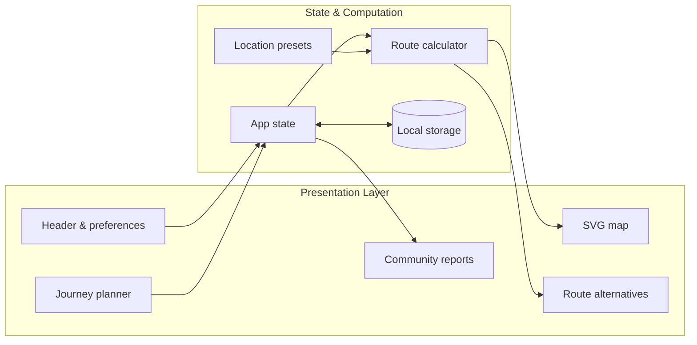
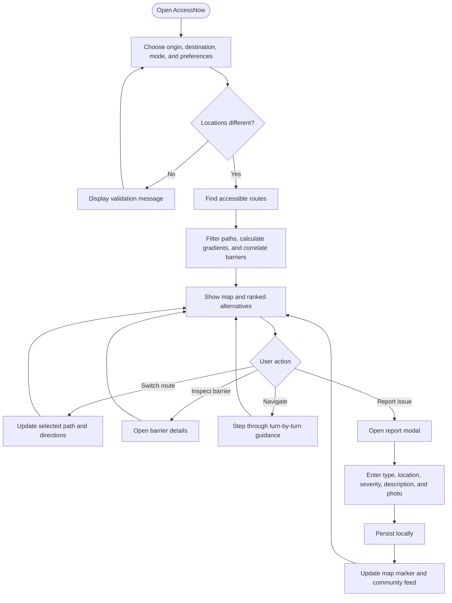
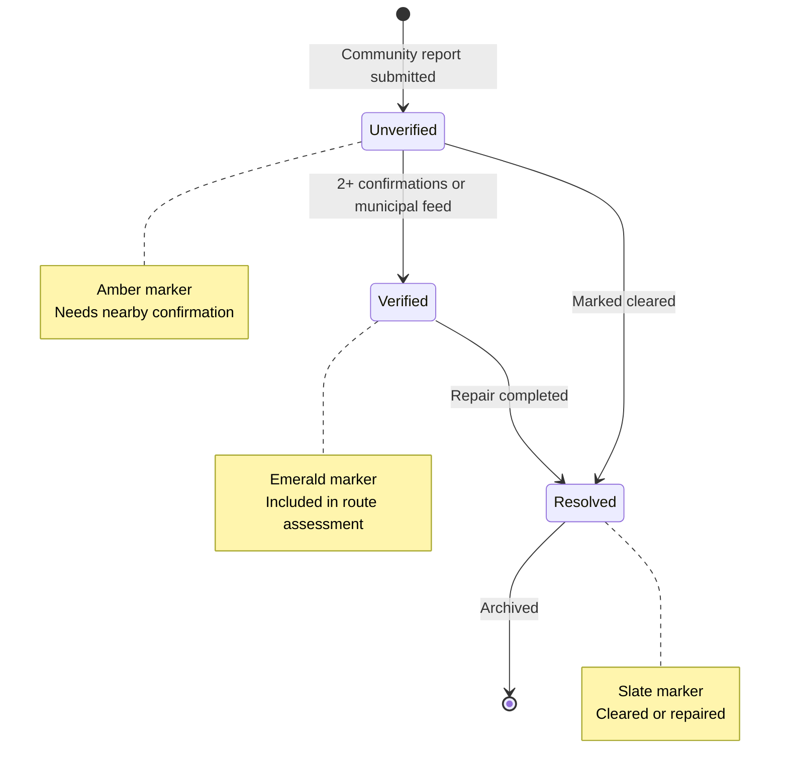

<div align="center">

# 🗺️ AccessNow

### Accessibility-aware trip planning for more inclusive cities

[](https://react.dev/)
[](https://www.typescriptlang.org/)
[](https://vitejs.dev/)
[](https://tailwindcss.com/)
[](LICENSE)
[](#privacy--data)

<p>
  Plan journeys around real mobility needs—not only distance and traffic.<br />
  AccessNow combines ranked accessible routes, community barrier reports, and private local-first storage.
</p>

[**Explore the project**](https://github.com/Sayan-Mukherjee99/Mapping) · [**Run locally**](#getting-started) · [**Report an issue**](https://github.com/Sayan-Mukherjee99/Mapping/issues)

</div>

---

## ✨ Why AccessNow?

Traditional navigation commonly prioritizes speed and vehicles. That can send wheelchair users, parents with strollers, older adults, and other travelers toward steep hills, missing curb cuts, broken elevators, or construction.

**AccessNow** puts mobility requirements first:

- ♿ **Mobility-aware alternatives** — compare routes for car, bike, and walking.
- 🛠️ **Barrier transparency** — clearly distinguish verified, unverified, and resolved reports.
- 🗺️ **Interactive local map** — explore routes and obstacles on a self-contained SVG map.
- 🔍 **Worldwide place search** — find addresses and landmarks with OpenStreetMap and Photon.
- 🔒 **Privacy-first design** — no API keys, trackers, or external map service dependencies.

> AccessNow is a civic-tech prototype: route data and urban barriers are modeled for demonstration and are not a substitute for real-time municipal or professional accessibility guidance.

---

## 🧭 Key Features

| Feature | What it offers |
|:--|:--|
| **Accessible route ranking** | Up to three alternatives with step-free coverage, maximum gradient, duration, distance, and obstacle counts |
| **Real place search** | Free worldwide address and landmark search powered by OpenStreetMap and Photon |
| **Bespoke vector map** | District roads, waterfront, parks, crosswalks, landmarks, route paths, and barrier markers |
| **Turn-by-turn simulator** | Step through every maneuver with a focused route navigation preview |
| **Barrier reporting** | Submit seven barrier types with severity, description, location, and photo upload preview |
| **Community verification** | Search and filter reports, then confirm whether an obstacle is still present |
| **Adaptive preferences** | Prioritize step-free paths, working elevators, low slopes, audio crosswalks, and stair avoidance |
| **High-contrast mode** | A dedicated visual mode for users who need greater interface contrast |

---

## 🖼️ Interface Preview

> Add screenshots or a short demo GIF here to showcase the planner, map, route comparison, and community feed.

```text
[ Planner ]  →  [ Interactive Map ]  →  [ Accessible Routes ]  →  [ Turn-by-Turn Guidance ]
```

---

## 🏗️ System Architecture



### Application flow



---

## 🚦 Barrier Lifecycle



| Status | Meaning | Visual indicator |
|:--|:--|:--|
| **Unverified** | Recently reported and awaiting confirmation | Amber marker |
| **Verified** | Confirmed by the community or a municipal feed | Emerald marker |
| **Resolved** | Cleared, repaired, or archived | Slate marker |

---

## 📁 Project Structure

```text
src/
├── types/
│   └── index.ts                 # Domain types
├── data/
│   └── mockData.ts              # Presets and route generation
├── services/
│   └── geocoding.ts             # OpenStreetMap & Photon search
├── components/
│   ├── Header.tsx               # Navigation and preferences
│   ├── PlannerLanding.tsx       # Trip planner
│   ├── RealPlaceAutocomplete.tsx
│   ├── InteractiveMap.tsx       # SVG map and route overlays
│   ├── RouteOptionsList.tsx     # Ranked alternatives
│   ├── RouteDetailsPanel.tsx    # Turn-by-turn directions
│   ├── CommunityFeed.tsx        # Reports and verification
│   ├── ReportIssueModal.tsx     # Barrier submission
│   ├── ModifyPreferencesModal.tsx
│   └── AboutModal.tsx
├── App.tsx                      # Application state
├── main.tsx                     # React entry point
└── index.css                    # Tailwind and global styles
```

---

## 🚀 Getting Started

### Prerequisites

- [Node.js](https://nodejs.org/) 18 or later
- [npm](https://www.npmjs.com/) 9 or later

### Installation

```bash
git clone https://github.com/Sayan-Mukherjee99/Mapping.git
cd Mapping
npm install
```

### Start development

```bash
npm run dev
```

Open **http://localhost:5173** in a browser.

### Production build

```bash
npm run build
npm run preview
```

---

## 🔒 Privacy & Data

- No API keys or secret credentials are required.
- Search requests are sent to OpenStreetMap and Photon when live place search is used.
- Community reports created in the prototype are stored in browser `localStorage`.
- No analytics or third-party tracking is included in the application code.
- Environment files, certificates, build output, and dependencies should remain excluded through `.gitignore`.

---

## 🗺️ Demo Scope

The built-in district is inspired by a dense downtown civic and medical area featuring stations, plazas, hospitals, markets, libraries, parks, and waterfront locations.

The included data demonstrates:

- Urgent barriers
- Unverified community reports
- Verified obstacles
- Cleared or resolved barriers
- Municipal-style advisory notices

The map and route engine are demonstration implementations rather than a live navigation or municipal data service.

---

## 🤝 Contributing

Contributions are welcome.

1. Fork the repository.
2. Create a feature branch:

   ```bash
   git checkout -b feature/your-feature
   ```

3. Make your changes and run the production build:

   ```bash
   npm run build
   ```

4. Open a pull request with:
   - A clear summary
   - Relevant screenshots or recordings
   - Testing instructions
   - Any accessibility considerations

Please keep contributions focused, inclusive, and privacy-conscious.

---

## 📄 License

Licensed under the [MIT License](LICENSE).

<div align="center">

**Built to make every route feel possible.**

</div>
