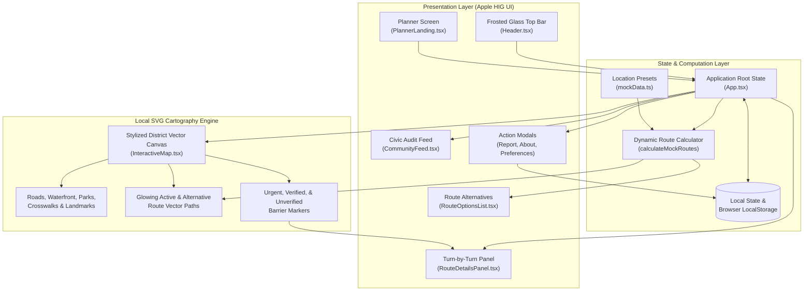
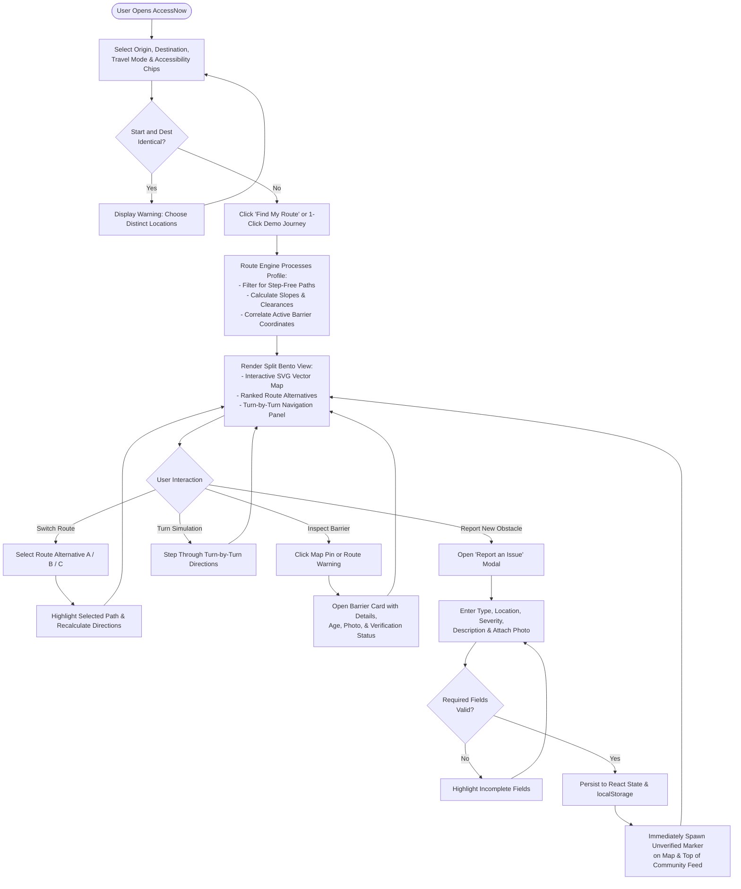
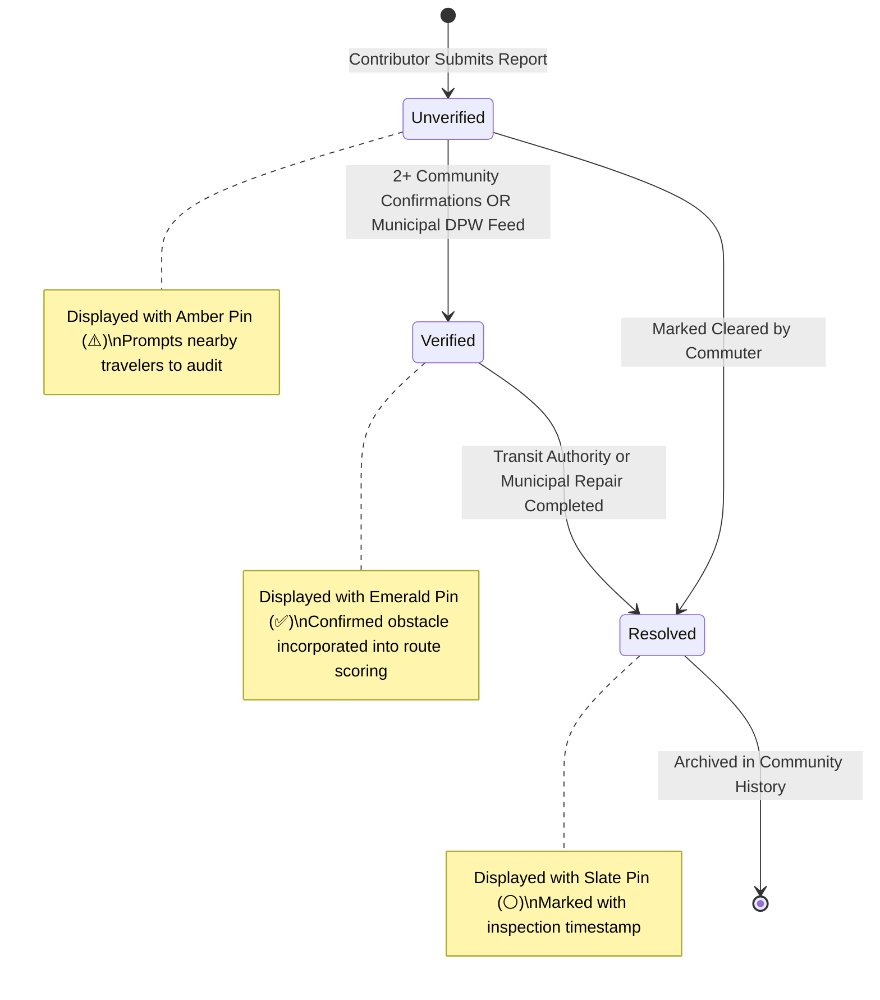

# AccessNow — Accessibility-Aware Trip Planner

<div align="center">

[](https://react.dev/)
[](https://www.typescriptlang.org/)
[](https://vitejs.dev/)
[](https://tailwindcss.com/)
[](LICENSE)
[](#-privacy--security-model)

<p align="center">
  <strong>A responsive, civic-tech web application that empowers individuals with mobility requirements to plan accessible journeys while transparently navigating community-reported urban barriers.</strong>
</p>

</div>

---

## 📖 Table of Contents

- [Overview & Product Vision](#-overview--product-vision)
- [Design Philosophy](#-design-philosophy)
- [System Architecture](#-system-architecture)
- [Application Flowchart](#-application-flowchart)
- [Barrier Audit State Machine](#-barrier-audit-state-machine)
- [Key Features](#-key-features)
- [Component Structure](#-component-structure)
- [Privacy & Security Model](#-privacy--security-model)
- [Getting Started](#-getting-started)
- [Demo Data & Assumptions](#-demo-data--assumptions)
- [Contributing](#-contributing)

---

## 🎯 Overview & Product Vision

Standard digital navigation systems optimize almost exclusively for speed and vehicular traffic, routinely misdirecting wheelchair users, parents with strollers, and seniors toward steep inclines, missing curb cuts, broken transit elevators, or construction zones.

**AccessNow** solves this by:
1. **Prioritizing Mobility Profiles**: Generating multiple route alternatives based on physical accessibility (100% step-free corridors, gentle slope gradients `< 3%`, and level-boarding transit).
2. **Exposing Uncertainty**: Treating city infrastructure honestly by acknowledging that urban conditions change rapidly. Barrier reports are transparently categorized as **Verified**, **Unverified**, or **Resolved**.
3. **Zero Third-Party Dependencies**: Self-contained SVG cartography and client-side processing ensure 100% availability, privacy, and zero reliance on paid external map services.

---

## 🎨 Design Philosophy

AccessNow is styled after **Apple’s Human Interface Guidelines** to provide a calm, trustworthy civic utility:

* **Canvas & Surfaces**: Apple neutral canvas (`#F5F5F7`), pure white elevated bento cards (`#FFFFFF`), primary ink in `#1D1D1F`, secondary copy in `#6E6E73`, and 1px hairline borders (`rgba(0, 0, 0, 0.08)`).
* **System Color Tokens**:
  * 🔵 **Apple System Blue (`#0071E3`)**: Primary actions, active route paths, and selection states.
  * 🟢 **System Emerald (`#34C759`)**: Step-free verified states, audio crosswalk signals, and cleared reports.
  * 🟠 **System Amber (`#FF9F0A`)**: Unverified community alerts and advisory cautions.
  * 🔴 **System Red (`#FF3B30`)**: Strictly reserved for urgent impassable barriers (e.g. vehicle blocking a curb cut).
* **Typography**: Native Apple font stack (`-apple-system, BlinkMacSystemFont, "SF Pro Display", "SF Pro Text", "Inter"`), tight headline tracking (`-0.025em`), and generous whitespace.
* **Micro-Interactions**: Pill-shaped action buttons (`border-radius: 9999px`), active press compression (`scale(0.98)`), macOS/iOS-style segmented pill controls, and spring-timed transitions (`cubic-bezier(0.25, 0.1, 0.25, 1)`).

---

## 🏗 System Architecture

The following diagram details the modular architecture of AccessNow, illustrating the relationship between UI components, the routing computation engine, the cartography pipeline, and offline persistence.



---

## 🔄 Application Flowchart

This flowchart outlines the end-to-end trip planning, route selection, and community reporting workflows.



---

## 🚦 Barrier Audit State Machine

Every accessibility barrier reported by the community moves through a lifecycle designed to prevent stale or inaccurate data:



---

## ⚡ Key Features

| Feature | Description |
| :--- | :--- |
| **Bespoke Vector Map** | Stylized SVG district map containing Grand Concourse, Broad St, 5th Ave, Waterfront Harbor, piers, parks, crosswalks, and landmark footprints. Zero API keys required. |
| **Ranked Accessible Routes** | Computes up to 3 routes per query with metrics: Step-Free %, Max Gradient %, Estimated Duration, Distance, and Active Obstacle Count. |
| **Interactive Route Simulator** | Step-by-step navigation preview walking the user through each maneuver with tactile guides and push-button doorway indicators. |
| **Community Reporting Modal** | Comprehensive reporting for 7 barrier types (elevators, curb cuts, stairs, trenches, etc.) with file upload preview and demo sample photos. |
| **Crowd Verification Feed** | Live community feed supporting search, category tabs (*All*, *Urgent*, *Unverified*, *Verified*, *Resolved*), and *“Confirm Still There”* upvotes. |
| **Adaptive Preferences** | Modify travel modes or toggle priorities (*Step-free*, *Avoid stairs*, *Working elevators*, *Low slopes*, *Audio crosswalks*) with immediate route recalculation. |
| **High Contrast Accessibility** | Dedicated High Contrast Mode for vision-impaired users alongside full WCAG AAA compliant color ratios. |

---

## 📂 Component Structure

```text
src/
├── types/
│   └── index.ts                 # TypeScript domain types (Routes, Barriers, Modes, Locations)
├── data/
│   └── mockData.ts              # Preset district landmarks & algorithmic route generator
├── components/
│   ├── Header.tsx               # Frosted navigation bar with contrast & modal triggers
│   ├── PlannerLanding.tsx       # Welcoming landing page with iOS-style segmented controls
│   ├── InteractiveMap.tsx       # SVG vector cartography, route overlays & pin popovers
│   ├── RouteOptionsList.tsx     # Bento list of calculated route alternatives
│   ├── RouteDetailsPanel.tsx    # Turn-by-turn steps, civic disclaimer & simulator
│   ├── CommunityFeed.tsx        # Filterable community audit reports & upvoting
│   ├── ReportIssueModal.tsx     # Apple-style modal for filing barrier reports
│   ├── ModifyPreferencesModal.tsx # Drawer for updating route priorities
│   └── AboutModal.tsx           # Transparency guide explaining verification tiers
├── index.css                    # Tailwind setup, Apple frosted glass & scrollbar styles
├── App.tsx                      # Top-level state orchestration & localStorage syncing
└── main.tsx                     # React DOM entrypoint
```

---

## 🔒 Privacy & Security Model

AccessNow follows strict privacy-first engineering practices:

* **Zero External API Calls**: The application makes no network calls to external mapping services, geocoders, or analytics trackers.
* **No Secret Leaks**: No API keys, credentials, or private access tokens exist in the source code or client bundles.
* **Local Storage Isolation**: Community reports created in the prototype are persisted solely within the client's local browser (`localStorage`), ensuring complete data privacy.
* **Exhaustive `.gitignore`**: All `.env*` variants, `.pem` certificates, build artifacts (`dist/`), and `node_modules/` are strictly ignored.

---

## 🚀 Getting Started

### Prerequisites
- [Node.js](https://nodejs.org/) (version 18 or later)
- [npm](https://www.npmjs.com/) (version 9 or later)

### Installation
```bash
# Clone the repository
git clone https://github.com/Sayan-Mukherjee99/Mapping.git

# Navigate into the project folder
cd Mapping

# Install dependencies
npm install
```

### Development Server
```bash
# Launch the Vite local dev server
npm run dev
```
Open **[http://localhost:5173/](http://localhost:5173/)** in your web browser.

### Production Build & Preview
```bash
# Typecheck and build optimized static assets
npm run build

# Preview the production build locally
npm run preview
```

---

## 🗺 Demo Data & Assumptions

* **District Scope**: Modeled after a dense urban *Downtown Civic & Medical District* featuring Metro Central Station, City Hall Plaza, Mercy General Hospital, Union Market Square, Riverside Library, and the Innovation Tech Campus.
* **Civic Data Feeds**: Preloaded with realistic municipal Department of Public Works (DPW) notices and commuter audits to demonstrate the full lifecycle of urgent, unverified, and resolved barriers.

---

## 📄 License

This project is licensed under the [MIT License](LICENSE) — feel free to use, modify, and distribute it for community and civic initiatives.
